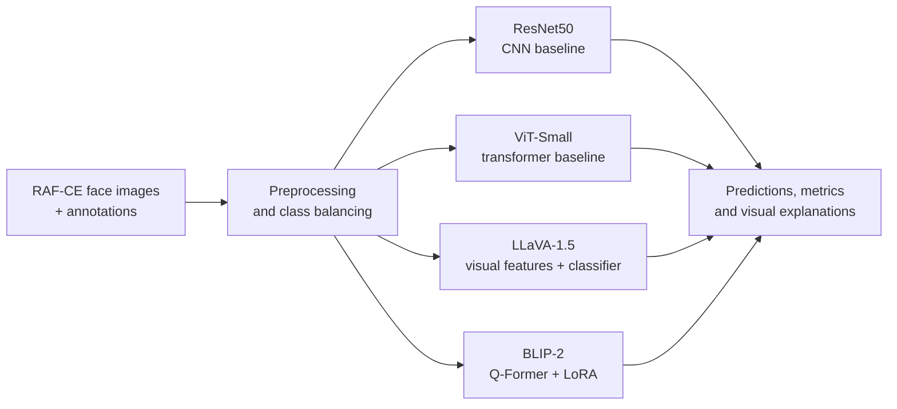
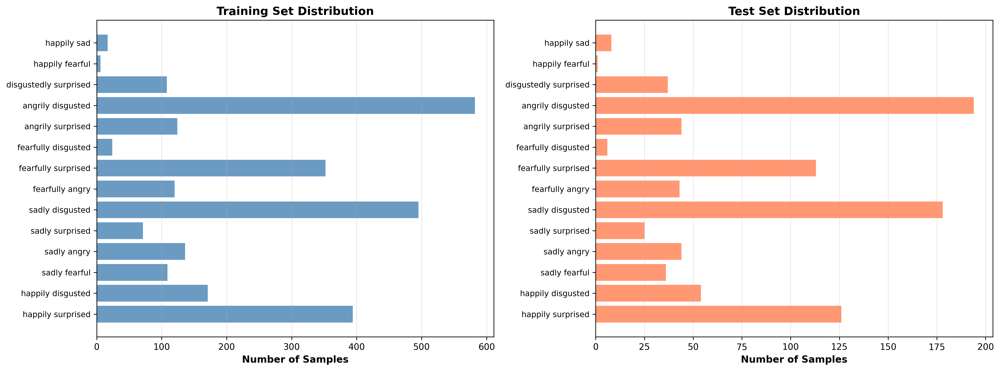

# Beyond binary emotions

### A vision–language study of compound facial expressions

What happens when a facial expression combines emotions—like *happily surprised* or *sadly angry*? This project explores that question on RAF-CE, comparing convolutional, transformer, and vision–language approaches across 14 compound-expression classes.

**[Read the paper on ResearchGate](https://www.researchgate.net/publication/417912615_Beyond_Binary_Emotions_A_Multi-Architecture_Vision-Language_Approach_for_Compound_Facial_Expression_Recognition)** · **[Explore notebooks](#experiment-notebooks)** · **[See reported results](#reported-results--an-important-caveat)** · **[Cite this work](#citation)**

---

## 📄 The research

**Beyond Binary Emotions: A Multi-Architecture Vision-Language Approach for Compound Facial Expression Recognition**

Rana Romdhane, Ghalia Ben Aissa, Ghada Mhadhbi, Oulimata Sall, Khaoula ElBedoui and Walid Barhoumi.

**Conference paper · COC'2026 · Thiès, Senegal · March 2026**

The paper investigates ResNet50, ViT-Small, LLaVA-1.5 and BLIP-2 on RAF-CE, and discusses Grad-CAM, SHAP and a Streamlit prototype.

**[Read on ResearchGate](https://www.researchgate.net/publication/417912615_Beyond_Binary_Emotions_A_Multi-Architecture_Vision-Language_Approach_for_Compound_Facial_Expression_Recognition)** · [Repository PDF](https://github.com/RanaRomdhane/Vision-LLM-compound-emotions/blob/main/article_and_presentations/Article_VLM_COC2026_CR.pdf) · [Article and presentations](https://github.com/RanaRomdhane/Vision-LLM-compound-emotions/tree/main/article_and_presentations)

> [!IMPORTANT]
> The paper reports strong BLIP-2 results, but the repository's evaluation notebook includes the ground-truth emotion in the model's test prompt. Those figures should **not** be interpreted as label-blind recognition performance. See [the evaluation caveat](#reported-results--an-important-caveat) before using the comparison.

## 🧭 Navigation

- [The idea](#-the-idea)
- [Dataset](#-dataset)
- [Reported results and caveat](#reported-results--an-important-caveat)
- [Experiment notebooks](#experiment-notebooks)
- [Getting started](#-getting-started)
- [Repository map](#-repository-map)
- [Citation](#citation)

## 💡 The idea

The study follows a shared task—classifying an aligned facial image into one of 14 compound labels—through several model families. The paths below summarize the paper's experimental design rather than a single deployed pipeline.



The repository includes Grad-CAM and integrated-gradient visualizations for the vision baselines, and SHAP and Grad-CAM material for BLIP-2. These are interpretability aids, not proof of a model's reasoning or clinical reliability.

## 🗂 Dataset

The paper describes **3,618 usable RAF-CE images**, with **2,709 training** and **909 test** samples across **14 classes**; the repository's [dataset configuration](https://github.com/RanaRomdhane/Vision-LLM-compound-emotions/blob/main/results/dataset_config.json) records the same train/test counts. The classes are imbalanced, making per-class metrics important alongside accuracy.



<sub>Class distribution visualization from the repository. See the [label mapping](https://github.com/RanaRomdhane/Vision-LLM-compound-emotions/blob/main/dataset/label_mapping.json) for the class names.</sub>

<details>
<summary><strong>View all 14 labels</strong></summary>

Happily surprised · Happily disgusted · Sadly fearful · Sadly angry · Sadly surprised · Sadly disgusted · Fearfully angry · Fearfully surprised · Fearfully disgusted · Angrily surprised · Angrily disgusted · Disgustedly surprised · Happily fearful · Happily sad

</details>

The repository contains aligned images, label and partition files, and action-unit annotations under [`dataset/raw`](https://github.com/RanaRomdhane/Vision-LLM-compound-emotions/tree/main/dataset/raw). Check the original RAF-CE dataset's access and usage terms before reuse; no dataset license is specified in this repository.

## Reported results & an important caveat

The paper and [`all_models_comparison.csv`](https://github.com/RanaRomdhane/Vision-LLM-compound-emotions/blob/main/results/all_models_comparison.csv) report the following figures. F1 is macro-averaged in the paper. **These are repository-reported experiment outputs, not independently reproduced results.**

| Model | Accuracy | Macro F1 | Interpretation |
|:--|--:|--:|:--|
| ResNet50 | 44.55% | 29.09% | CNN baseline |
| ViT-Small | 47.63% | 30.60% | Transformer baseline |
| LLaVA-1.5 | 60.73% | 44.40% | Test set used for model selection |
| BLIP-2 | 96.81% | 97.91% | Ground-truth label included in test prompt |

> [!CAUTION]
> In the [BLIP-2 comparison notebook](https://github.com/RanaRomdhane/Vision-LLM-compound-emotions/blob/main/notebooks/Step4_Final_Execute_BLIP_2_SHAP_Comparison_Summary.ipynb), `_create_prompt` inserts the example's ground-truth emotion into “why it shows {emotion}”; the evaluation then passes that prompt to the model and extracts an emotion from the generated text. The reported BLIP-2 scores therefore do not establish label-blind classification accuracy. The [LLaVA notebook](https://github.com/RanaRomdhane/Vision-LLM-compound-emotions/blob/main/notebooks/Step2_VISION_LLM_LLAVA.ipynb) also evaluates on test features during training and uses those metrics to choose a checkpoint. Re-evaluate with a label-free prompt, a separate validation set and an untouched test set before comparing models or making performance claims.

<details>
<summary><strong>Open the saved analyses</strong></summary>

- [Per-class comparison](https://github.com/RanaRomdhane/Vision-LLM-compound-emotions/blob/main/results/per_class_comparison.csv)
- [ResNet50 confusion matrix](https://github.com/RanaRomdhane/Vision-LLM-compound-emotions/blob/main/results/visualizations/3_resnet_confusion_matrix.png)
- [ViT confusion matrix](https://github.com/RanaRomdhane/Vision-LLM-compound-emotions/blob/main/results/visualizations/5_vit_confusion_matrix.png)
- [LLaVA confusion matrix](https://github.com/RanaRomdhane/Vision-LLM-compound-emotions/blob/main/results/visualizations/llava_confusion_matrix.png)
- [BLIP-2 SHAP visualization](https://github.com/RanaRomdhane/Vision-LLM-compound-emotions/blob/main/results/results_blip2/shap_analysis.png) — subject to the evaluation caveat above

</details>

## Experiment notebooks

| Step | Notebook | Purpose |
|:--|:--|:--|
| 0 | [Preprocessing](https://github.com/RanaRomdhane/Vision-LLM-compound-emotions/blob/main/notebooks/Step0_Preprocessing.ipynb) | Load RAF-CE data, inspect distribution and prepare class weights |
| 1 | [ResNet50 & ViT](https://github.com/RanaRomdhane/Vision-LLM-compound-emotions/blob/main/notebooks/Step1_VISION-LLM-RESNET-VIT-Baselines.ipynb) | Train baselines and generate explanations |
| 2 | [LLaVA](https://github.com/RanaRomdhane/Vision-LLM-compound-emotions/blob/main/notebooks/Step2_VISION_LLM_LLAVA.ipynb) | Extract vision features and train a classifier |
| 3 | [BLIP-2](https://github.com/RanaRomdhane/Vision-LLM-compound-emotions/blob/main/notebooks/Step3_VISION_LLM_BLIP2.ipynb) | Fine-tune and evaluate BLIP-2 with LoRA |
| 4 | [SHAP & comparison](https://github.com/RanaRomdhane/Vision-LLM-compound-emotions/blob/main/notebooks/Step4_Final_Execute_BLIP_2_SHAP_Comparison_Summary.ipynb) | Explanations and saved model comparison |
| App | [Streamlit prototype](https://github.com/RanaRomdhane/Vision-LLM-compound-emotions/blob/main/notebooks/APP_STREAMLIT_VISION_LLM.ipynb) | Generate the prototype app from a notebook |

## 🚀 Getting started

1. **Clone the repository** and inspect the notebooks before executing them:

   ```bash
   git clone https://github.com/RanaRomdhane/Vision-LLM-compound-emotions.git
   cd Vision-LLM-compound-emotions
   ```

2. **Choose a notebook environment.** Several notebooks use Google Colab and a shared Google Drive; the BLIP-2 notebook also contains machine-specific paths. Update paths to your own dataset, source, results and model directories. GPU access is needed for the larger models.
3. **Install dependencies from the notebook you plan to run.** They include PyTorch/torchvision, Transformers, PEFT, scikit-learn and visualization packages; exact package versions are not locked in the repository. Follow the individual installation cells and verify compatibility with your environment.
4. **Supply the required checkpoints.** The notebooks reference model files and adapters under a Drive `models/` directory; those trained checkpoints are not present on the repository's main branch. Pretrained model downloads and sufficient storage may also be needed.
5. **Start with preprocessing and a baseline.** For a rigorous new comparison, correct the evaluation protocol described above and keep the final test set out of model selection. The prototype notebook generates an app and depends on the same external model paths; it is not a standalone turnkey app in this checkout.

<details>
<summary><strong>Dataset loader notes</strong></summary>

[`src/dataset.py`](https://github.com/RanaRomdhane/Vision-LLM-compound-emotions/blob/main/src/dataset.py) provides a PyTorch dataset and loaders, training augmentation and optional weighted sampling. It uses partition IDs `0` for train, `1` for test and `2` for validation. Missing images are replaced with a blank image by this loader, so check file availability explicitly before training or evaluation.

</details>

## 🧱 Repository map

```text
article_and_presentations/   Paper and presentation materials
dataset/                     Labels, partitions, aligned images and class weights
notebooks/                   Preprocessing, model experiments and app prototype
results/                     Metrics, predictions and visualizations
src/dataset.py               PyTorch dataset and data loaders
rapport_technique___vision_llm.pdf   Technical report
```

## ⚠️ Scope and responsible use

This is a research project, not a validated clinical or production system. Facial expressions alone do not reliably reveal a person's internal emotional state; dataset imbalance, demographic and contextual shifts, privacy, and consent all matter. Do not use these models for sensitive decisions about individuals without appropriate validation and safeguards.

## Citation

If you use this repository or discuss the paper, cite it with the details below. The title and author names follow the repository PDF; the conference, location and date follow its ResearchGate listing. No DOI is listed there.

```bibtex
@misc{romdhane2026beyond,
  title  = {Beyond Binary Emotions: A Multi-Architecture Vision-Language Approach for Compound Facial Expression Recognition},
  author = {Romdhane, Rana and Ben Aissa, Ghalia and Mhadhbi, Ghada and Sall, Oulimata and ElBedoui, Khaoula and Barhoumi, Walid},
  year   = {2026},
  month  = mar,
  note   = {Conference paper, Colloque sur les Objets et syst\`emes Connect\'es (COC'2026), Thi\`es, Senegal},
  url    = {https://www.researchgate.net/publication/417912615_Beyond_Binary_Emotions_A_Multi-Architecture_Vision-Language_Approach_for_Compound_Facial_Expression_Recognition}
}
```

---

<sub>Built around the research materials and experiment outputs in this repository.</sub>
